<div align="center">

<picture>
  <source media="(prefers-color-scheme: dark)" srcset=".github/assets/banner-dark.svg">
  
</picture>

**Use [push-in/pam-native](https://github.com/push-in/pam-native): it is where PAM Native is developed and released.**<br>
This repository was the immutable Composer release split of the PAM Native PHP SDK; its last split is 1.0.36. Packagist's `pushinbr/pam-native` now resolves from push-in/pam-native, which ships the newer releases.


[](LICENSE)

[Install](#install) · [Contents](#contents) · [Docs](#docs) · [Canonical repository](https://github.com/push-in/pam-native)

</div>

<a id="install"></a>
## <picture></picture> Install

Create a PAM Native project with the current SDK:

```sh
pam init my-app --template native
cd my-app
pam doctor --fix
pam dev
```

`pam init --template native` already requires `pushinbr/pam-native` (`^1.0`). See the [PAM Native README](https://github.com/push-in/pam-native#readme).

<a id="platform-support"></a>
## <picture></picture> Platform support

| Platform | Support | Notes |
| --- | --- | --- |
| Android, iOS | Through push-in/pam-native | See the [PAM Native platform support](https://github.com/push-in/pam-native#readme) |
| PHP | 8.5+ | From `composer.json` |

<a id="contents"></a>
## <picture></picture> What is in this repository

The PHP SDK as split for the 1.0.36 release: `src/`, `resources/`, `bin/`, `tests/`, `benchmarks/` and [PROTOCOL.md](PROTOCOL.md). The README of that distribution (repository ownership, first application walk-through, HTTP) is preserved verbatim in **[docs/distribution-readme.md](docs/distribution-readme.md)**; nothing was removed.

Source, roadmap, architecture, issues, security reports and contributions live in [push-in/pam-native](https://github.com/push-in/pam-native).

<a id="docs"></a>
## <picture></picture> Docs

- [Previous README (1.0.36 distribution)](docs/distribution-readme.md)
- [PAM Native (canonical repository)](https://github.com/push-in/pam-native)
- [PAM Native overview](https://push-in.github.io/pam-docs/native/overview/)
- [Protocol](PROTOCOL.md)

<a id="pam-ecosystem"></a>
## <picture></picture> Part of the PAM ecosystem

<p align="center"><picture>
  <source media="(prefers-color-scheme: dark)" srcset=".github/assets/pam-wordmark-dark.svg">
  
</picture></p>

PAM runs PHP natively on servers, desktops and phones. This repository is one piece of it.

| [**PAM**](https://github.com/push-in/pam) | [**PAM Desktop**](https://github.com/push-in/pam-desktop) | [**PAM Native**](https://github.com/push-in/pam-native) | [**Ecosystem**](https://github.com/push-in/pam#ecosystem) |
| --- | --- | --- | --- |
| the runtime and CLI | native desktop apps in PHP | native Android and iOS apps in PHP | every official package and plugin |

<sub>Docs: [push-in.github.io/pam-docs](https://push-in.github.io/pam-docs/introduction/) · [Issues](https://github.com/push-in/pam-native-php/issues)</sub>

<p align="center"><sub><a href="LICENSE">Apache License 2.0</a> · Made in Brazil by Pushin</sub></p>
